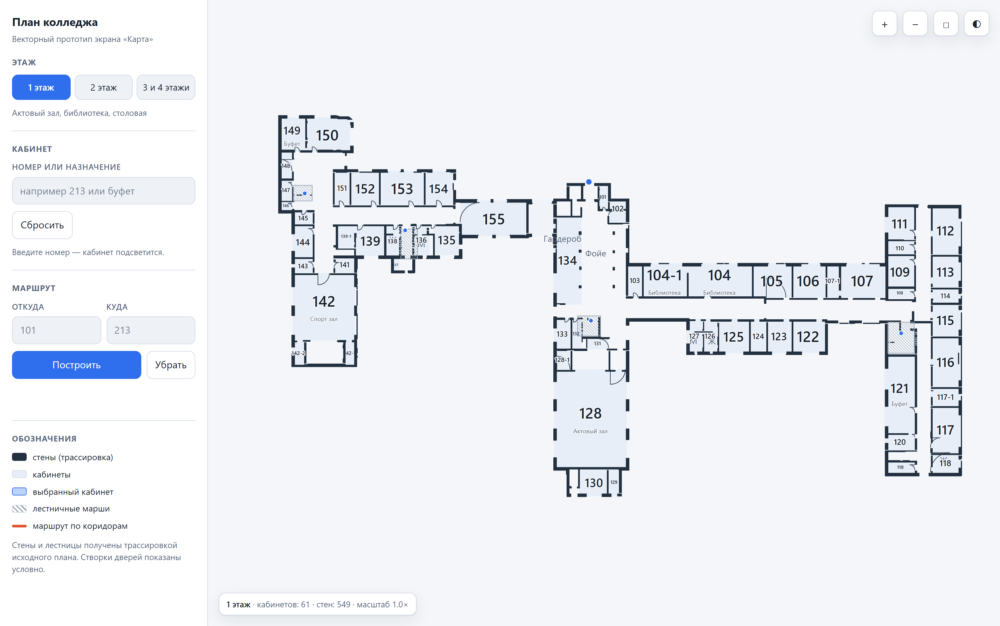
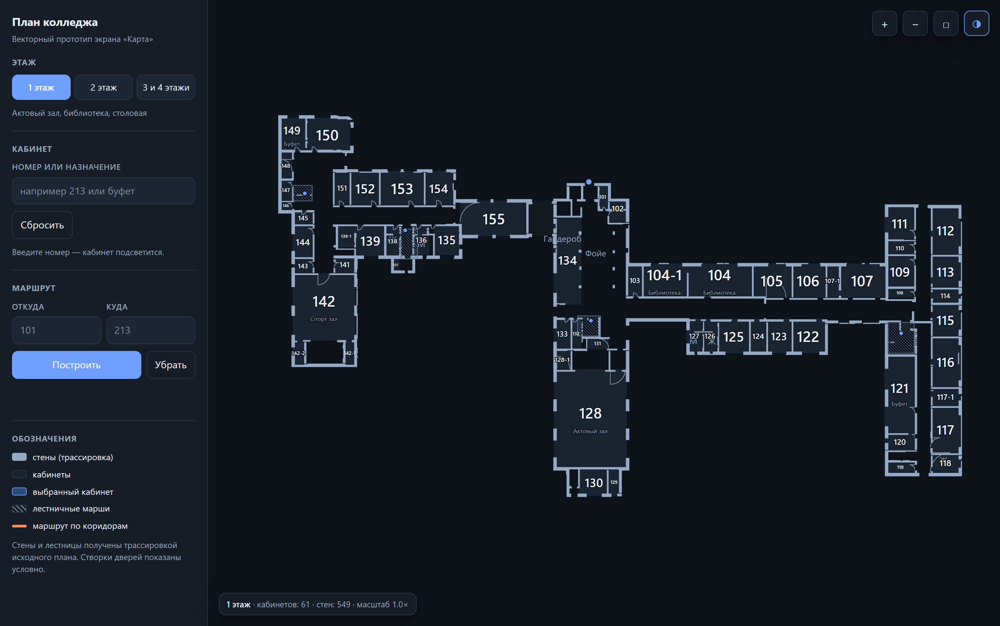
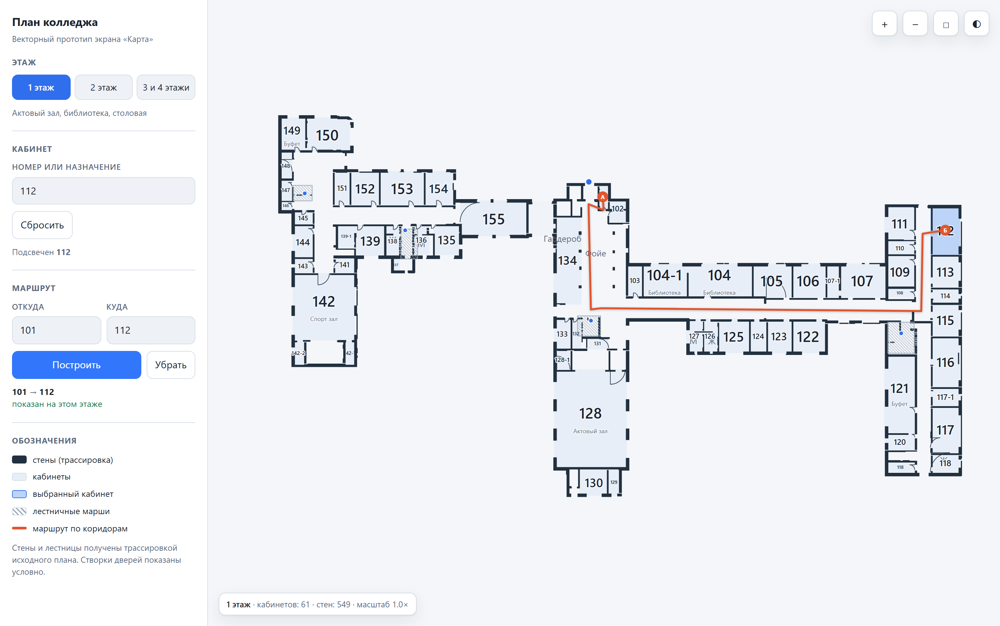
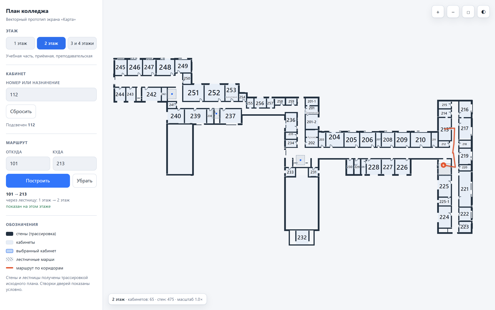
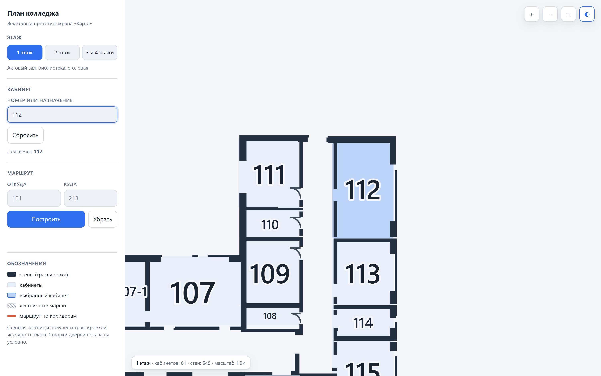

# Переработка экрана «Карта»: векторный план вместо растровой подложки

Дата: 2026-11-07 · Ветка: `v2.4-stable` · Код приложения не изменялся, сборка не запускалась.

## Коротко

Растровая подложка (`map_floor1.jpg`, `map_floor2.jpg`, `map_floor34.jpg`) заменена на трассированный векторный слой: **1490 прямоугольных участков стен, 180 дверных проёмов, 13 лестничных маршей** на трёх планах. Слой лежит отдельным ассетом и **не пересекается** с данными кабинетов, коридоров и маршрутов — поэтому поиск, подсветка и построение маршрута остаются ровно такими, какими были.

Собран рабочий прототип на чистом SVG (file://, без сети): `E:\MPK app\emulator-web-map\index.html`. Скриншоты — в `screens/`.

| | Было | Стало |
|---|---|---|
| Подложка | 3 JPEG 1376×768, 186 КБ | 1490 участков стен, 68 КБ JSON |
| Масштабирование | растр мылится, обводка «плывёт» | Path, чёткий на любом зуме |
| Тёмная тема | растр нельзя перекрасить | цвет стен из токенов темы |
| Правка плана | перерисовывать картинку | правится JSON |
| Размер в APK | 186 КБ картинок | 67 КБ данных (картинки удаляются) |

## Формат данных

Ассет: `app/src/main/assets/map_walls.json` (эталон — `_reports/map-rework-2026-11-07/data/map_walls.json`).
Координаты — **пиксели исходного растра**, холст 1376×768. Нормализация 0..1 выполняется на стороне отрисовки (делением на `PLAN_WIDTH`/`PLAN_HEIGHT`), в данных её нет: так нет потерь точности и нет двух источников истины.

```json
{
  "version": 1,
  "viewBox": [0, 0, 1376, 768],
  "source": "raster-trace",
  "floors": {
    "1": {
      "walls": [148,162,181,189, 148,189,181,215, ...],
      "stairs": [{ "x": 148, "y": 162, "w": 33, "h": 27, "area": 891, "fill": 0.61 }],
      "doors": [{ "roomId": "room_f5ozkcf", "side": "n", "x": 686, "y": 176,
                  "approx": true, "gap": [678, 694], "width": 16 }],
      "alignment": { "rooms": 62, "matched": 48, "ratio": 0.774,
                     "edge_on_wall_median": 0.55, "suspect": ["121", "120"] }
    }
  }
}
```

**`walls`** — плоский массив `[x0, y0, x1, y1, ...]`. Почему прямоугольники, а не полигоны-контуры: план строго ортогональный, а контурная обводка стен с проёмами даёт десятки тысяч точек и рваные края на стыках. Разложение на прямоугольники (слияние одинаковых горизонтальных ранов по вертикали) даёт ровно ту же картинку, но: проёмы дверей остаются реальными разрывами, массив читается в `FloatArray` за один проход, а в `Path` превращается один раз на этаж. Суммарная площадь стен — 130 193 px² (12.3% холста).

**`stairs`** — лестничные марши: прямоугольники со штриховкой. Позиция каждого привязана к входу `entrances[kind=stairs]` из `college_map.json` (это те же точки, по которым строятся межэтажные переходы), габариты сняты со штриховки; поле `source` = `hatch` или `entrance`, поле `approx` = `true`, когда марш найден только по точке входа. Лифтовых шахт план отдельным символом не обозначает, в данных их нет.

**`doors`** — проёмы. `side` — грань кабинета (`n/s/w/e`), `gap` — измеренные по растру границы проёма между простенками, `width` — ширина в пикселях. `approx: true` означает, что положение проёма измерено, а **направление створки условное** (открывание внутрь кабинета).

**Идентификаторы.** Слой стен не содержит id кабинетов: `doors[].roomId` ссылается на существующие id из `college_map.json`. Кабинеты, коридоры (`corridors`), узлы (`nodes`), входы (`entrances`), подписи (`labels`) и выноски (`callouts`) **не изменялись ни на байт** — поэтому `CollegeRouteFinder` и поиск работают с прежними данными. Целостность ссылок проверяется автоматически (`tools/validate.py`, далее — тест).

## Трассировка: как получено

Скрипт `tools/trace.py` (Python + OpenCV, воспроизводим):

1. Маска стен по яркости: `lum < 110`. Разделение чистое — стены 30–45, заливки кабинетов ~230, между ними разрыв в 5-м перцентиле (165).
2. Разложение маски на прямоугольники (RLE по строкам + слияние колонок по вертикали), отбрасывание участков меньше 2×2 px и площадью < 8 px².
3. Лестницы: маска серой штриховки (низкая насыщенность, яркость 140–212), компоненты связности с фильтром по площади (≥260 px²), минимальной стороне (≥17 px) и вытянутости (≤4.5). Найденные прямоугольники привязываются к входам `kind=stairs` с радиусом 34 px; совпавшие берут габариты штриховки, несовпавшие отбрасываются. **Позиции входов — источник истины**, потому что на них опирается маршрутизация. На 2 этаже штриховка есть и внутри кабинетов 204, 205, 206, 210, поэтому «по штриховке» получилось бы три ложных марша и три потерянных — привязка к входам это устранила.
4. Проёмы: от точки двери сканирование вдоль линии стены до ближайших простенков — так получается **измеренная** ширина проёма, а не назначенная.
5. Контроль: оверлеи трассировки на исходный растр (`debug/floor1.jpg` и др.).

Трассировка выполнена с файлов в репозитории. В `.claude/worktrees/t2b-verify/.../drawable/` лежат те же планы с меньшим сжатием (268–285 КБ против 56–70 КБ): если нужен более чистый край, трассировку стоит повторить по ним или по исходникам плана, скрипт от этого не меняется.

## Покрытие

| Этаж | Кабинетов | Реальных¹ | Со створкой | Без двери в данных | Стен | Маршей |
|---|---|---|---|---|---|---|
| 1 | 62 | 61 | 54 | 7 | 549 | 4 |
| 2 | 67 | 65 | 64 | 1 | 475 | 4 |
| 3–4 | 67 | 64 | 62 | 2 | 466 | 5 |
| **Итого** | **196** | **190** | **180** | **10** | **1490** | **13** |

¹ без статуса `nonexistent` (6 записей-заглушек в данных).

Кабинеты без двери (в `college_map.json` поле `door` пустое — у них нет и створки на плане): этаж 1 — 107-1, 129, 130, 137, 104-1, 142-1, 142-2 (7); этаж 2 — «Архив» без номера (`room_sb86niu`, 1); этаж 3–4 — 316, 318-1 (2). Это дефект исходных данных, а не трассировки: он был и до переработки.

**Этаж 3–4 — один план на два этажа**, как и раньше: 59 кабинетов 3xx и 5 кабинетов 4xx (401–405) размечены на одном холсте, поэтому маршрут между 3xx и 4xx строится по этому же плану без перехода по лестнице.

## Совпадение с растром

Прямоугольники кабинетов в `college_map.json` заданы **центром** (`x`, `y` — центр, `w`, `h` — размеры), а не левым верхним углом; это же соглашение использует `CollegeRouteFinder.kt:271-274`. При такой трактовке прямоугольники ложатся на план 1:1 (проверено оверлеем `debug/rooms_basis.png`: красные рамки — центр-базис, зелёные — ошибочный top-left-базис).

Метрика совпадения: доля периметра кабинета, лежащая на трассированных стенах (проёмы дверей и открытые границы дают разрывы, поэтому порог не 100%), и доля площади кабинета, занятая стенами.

| Этаж | Кабинетов | Совпало (кромка ≥35%, стены внутри ≤30%) | Медиана кромки на стене |
|---|---|---|---|
| 1 | 62 | 48 (77.4%) | 0.55 |
| 2 | 67 | 62 (92.5%) | 0.64 |
| 3–4 | 67 | 57 (85.1%) | 0.55 |

Типичное значение «стены внутри прямоугольника» 0.08–0.25 — это толщина стены, на которую проведена грань кабинета (прямоугольники кабинетов осевые, по осям стен). Это норма, а не рассогласование.

**Кабинеты, которые стоит сверить с завхозом** (кромки чаще всего на открытом пространстве — граничат с холлами, пунктирными перегородками или размечены по площади иначе, чем на плане):

- этаж 1: 121, 120, 116, 122, 118, 126, 117, 106, 127, 142, 125, 129;
- этаж 2: 218, 220, 234, 219;
- этаж 3–4: 306, 341, 308, 314, 313, 316-1, 315, 311-1, 312 и `room_fs6ui4g` (без номера).

## Прототип

Открывается двойным щелчком по `E:\MPK app\emulator-web-map\index.html` — только `file://`, без сети, CDN и npm. Данные лежат рядом в `map-data.js` (генерируется `tools/export_web.py`).

Что умеет:

- векторный план этажа: стены, кабинеты, номера, подписи помещений, штриховка лестниц, створки дверей, входы;
- переключение этажей 1 / 2 / 3–4;
- зум колесом и двойным щелчком, панорама перетаскиванием, пинч на тач-экранах, «вписать план»;
- поиск кабинета по номеру или назначению («213», «буфет») с подсветкой и наведением;
- маршрут между двумя кабинетами по графу коридоров (алгоритм Дейкстры, как в приложении) с автоматическим переходом на нужный этаж и указанием лестницы;
- тёмная и светлая темы;
- клавиатура: `+`, `-`, `0` (вписать), `Enter` в полях маршрута; видимый фокус, контраст текста и линий проверен в обеих темах.

Скриншоты (`screens/`):







Прототип — демонстрация формата и отрисовки, а не эталон поведения: он показывает маршрут по осям коридоров без ортогонализации и обхода кабинетов, которую делает `CollegeRouteFinder`. В приложении этот шаг уже реализован и не меняется.

## План интеграции в Compose

Ключевое наблюдение: в `CollegeMapScreen.kt` уже есть готовая система координат. `MapCanvas` считает `imgW × imgH`, а эта пропорция равна `CollegeRouteFinder.PLAN_ASPECT = 1376f / 768f` (`CollegeRouteFinder.kt:450`), то есть **ровно холсту трассировки**. Всё, что рисуется поверх (кабинеты, номера, маршрут, жесты, hit-тест), уже работает в этих координатах. Поэтому замена локальна: убирается `Image(painter)` и пропорция, взятая из `painter.intrinsicSize`.

Шаг 1. Ассет. Положить `data/map_walls.json` в `app/src/main/assets/map_walls.json`. Ничего не переименовывать: загрузчик ищет именно этот файл.

Шаг 2. Модель. Скопировать `compose/MapWallsData.kt` в `app/src/main/java/com/politex/data/model/MapWallsData.kt`. Загрузка идёт через `ContentAssets.open` — тем же путём, что `CollegeMapData.load`, поэтому контент-пакет подхватит файл автоматически.

Шаг 3. Загрузка один раз. В `MpkApplication.kt` в `AppGraph.init` добавить `val mapWalls = MapWallsData.load(app)` рядом с `scheduleRepository`. Парсинг 67 КБ — единицы миллисекунд, повторять его в композиции нельзя.

Шаг 4. Пропорция. `CollegeMapScreen.kt:976-980`:

```kotlin
// было
val painter = painterResource(id = mapRes(floorId))
val aspect = painter.intrinsicSize.let { s ->
    if (s.height > 0f && s.width > 0f) s.width / s.height else 1.7917f
}
// стало
val aspect = CollegeRouteFinder.PLAN_ASPECT
```

Шаг 5. Подложка. `CollegeMapScreen.kt:1152-1160`:

```kotlin
// было
Image(
    painter = painter,
    contentDescription = "План этажа",
    contentScale = ContentScale.Fit,
    modifier = Modifier.width(with(density) { imgW.toDp() }).height(with(density) { imgH.toDp() }),
)
// стало
MapWallsLayer(
    floorId = floorId,
    walls = AppGraph.mapWalls,
    imgW = imgW,
    imgH = imgH,
    wallColor = ColorMapWall,
    stairColor = ColorMapStair,
    modifier = Modifier.width(with(density) { imgW.toDp() }).height(with(density) { imgH.toDp() }),
)
```

Слой остаётся **под** `Canvas` с `drawMap` — порядок отрисовки не меняется, подсветка и номера по-прежнему сверху.

Шаг 6. Цвета. Добавить в файл цветовых токенов три значения и брать их из темы: `ColorMapWall` (светлая `#22303F`, тёмная `#93A9C4`), `ColorMapStair` (`#9AA7B6` / `#63758C`). Это то, что растр дать не мог.

Шаг 7. Постепенный откат. Один релиз держать обе ветки:

```kotlin
if (AppGraph.mapWalls.isEmpty) {
    Image(painter = painter, ...)   // старый путь
} else {
    MapWallsLayer(...)
}
```

Так выкатка не зависит от того, доехал ли ассет в контент-пакете. После подтверждения на устройствах — удалить `map_floor*.jpg` (186 КБ), `mapRes()` (`CollegeMapScreen.kt:1605-1609`) и импорт `painterResource`.

Шаг 8. Заготовки. `compose/MapWallsLayer.kt` — рендерер (Path из `FloatArray`, штриховка маршей, дуги створок), `compose/MapWallsData.kt` — модель и загрузчик, `compose/MapWallsDataTest.kt` — тесты. Файлы лежат в `_reports`, в `app/src` не вносились.

Производительность: `Path` строится один раз на этаж через `remember(floorId, imgW, imgH)` (1490 `addRect`, ~1–2 мс), в кадре — один `drawPath`. При жестах `imgW`/`imgH` не меняются, пересборки нет. Альтернатива при желании — `Modifier.drawWithCache`.

## Тесты

Юнит-тесты, которые стоит добавить (черновик — `compose/MapWallsDataTest.kt`):

1. `ассет читается и содержит все этажи` — гейт от «файл не доехал в APK», самый частый сбой ассетов.
2. `стены внутри холста плана` — ловит выход за 0..1376 / 0..768 и вырожденные участки.
3. `каждый проём ссылается на существующий кабинет` — связывает слой стен с `college_map.json`; падает, если кабинет переименовали или удалили.
4. `кромки кабинетов лежат на стенах` (порог 90% кабинетов, минимум 2 кромки из 4) — регресс-гейт: если кто-то сдвинет кабинеты или перегенерирует стены другим порогом, тест упадёт. Именно этот тест удерживает «1:1» от расползания.

Геометрия (дополнить существующие):

5. `hitTestRoom` (уже есть, `CollegeMapScreen.kt:734`) — точка в центре кабинета возвращает этот кабинет; точка вне кабинетов — `null`. База центра-координат закреплена тестом, чтобы её случайно не перевели в top-left.
6. `CollegeMap.floorForRoom` — `101 → 1`, `213 → 2`, `311 → 3-4`, `401 → 3-4`, `"" → null`.
7. Маршрут по коридорам: каждая точка маршрута лежит не дальше `width/2` от какой-либо полилинии `corridors` этого этажа (проверка, что маршрут не срезает через кабинеты). Дополняет существующие `CollegeRouteFinderTest` и `RealMapRouteOrthogonalityTest`.
8. Межэтажный маршрут: `101 → 213` имеет два участка, стык — на общей лестнице (совпадение координат входов разных этажей в пределах 0.02).

Визуальные: в проекте используется Roborazzi — добавить снимок экрана карты для этажа 1 в светлой и тёмной темах, чтобы отловить регресс штриховки дверей и толщины стен.

## Риски и ограничения

1. **Сомнительные кабинеты** (список выше, 26 из 196) — данные кабинетов и план в этих местах расходятся. Вектор это не исправляет и не ухудшает, но теперь расхождение видно глазами. Нужна сверка с завхозом.
2. **Двери условны.** Положение и ширина проёма измерены по растру, направление открывания — нет (на плане дуги нарисованы мелко). В данных стоит `approx: true`. Если створки мешают — их можно не рисовать, стены уже имеют реальные разрывы.
3. **Пунктирные линии** (остекление, лоджии) трассируются как стены, потому что проходят по тому же порогу яркости. На плане они и есть линии; если нужно отличать капитальные стены от остекления — потребуется отдельный признак и ручная разметка.
4. **Штриховка лестниц сама по себе ненадёжна**: на 2 этаже диагональная штриховка встречается внутри кабинетов, а часть маршей залита цветом пола. Поэтому позиции берутся из `entrances`, а штриховка уточняет только габариты. На 1 и 3–4 этажах все марши совпали со штриховкой (9 из 9), на 2 этаже — 1 из 4, остальные три помечены `approx` и имеют типовой размер 30×34 px. При замене растра или данных входов привязку нужно проверить оверлеем (`debug/`).
5. **Масштаб неизвестен:** `scaleMeters` в `college_map.json` равен `null`. Длину маршрута в метрах прототип оценивает по медианной ширине дверного проёма (0.9 м) и помечает как оценку. Для честных метров нужен один замер на местности.
6. **Этаж 4** отдельного плана не имеет: кабинеты 401–405 размечены на холсте 3 этажа. Это существующее соглашение, а не регресс переработки, но на векторе заметно, что часть этих прямоугольников соседствует с лестничной клеткой вплотную — при сверке планировки 4 этажа стоит проверить их отдельно.
7. **Слой не редактируется в `tools/map-editor.html`** — редактор работает с кабинетами. Правка стен — через `trace.py` + при необходимости ручная правка JSON.

## Что дальше

1. Сверить 26 сомнительных кабинетов с фактической планировкой (завхоз/учебная часть) и поправить `college_map.json` — это улучшит и карту, и маршруты.
2. Заполнить `door` у 10 кабинетов без двери (этаж 1: 107-1, 129, 130, 137, 104-1, 142-1, 142-2; этаж 2: «Архив»; этаж 3–4: 316, 318-1) — сейчас у них нет ни створки, ни точки входа для маршрута.
3. Применить шаги 1–7 в `app/src` отдельным коммитом, прогнать `:app:testStandardDebugUnitTest`, снять Roborazzi.
4. После релиза удалить растры и `mapRes()`.
5. При появлении исходников плана в векторе (PDF/DWG) — заменить трассировку импортом, формат `map_walls.json` для этого менять не нужно: достаточно пересобрать `walls`/`stairs`/`doors`.
6. Занести масштаб (`scaleMeters`) — тогда длина маршрута станет настоящей, а не оценочной.

## Файлы работы

```
_reports/map-rework-2026-11-07/
  MAP-REWORK.md              этот отчёт
  data/map_walls.json        векторный слой (эталон ассета)
  compose/MapWallsData.kt    модель + загрузчик (заготовка)
  compose/MapWallsLayer.kt   рендерер Canvas (заготовка)
  compose/MapWallsDataTest.kt тесты (заготовка)
  tools/trace.py             трассировка растров
  tools/export_web.py        сборка данных прототипа
  tools/validate.py          проверка целостности
  tools/shoot.py             скриншоты прототипа
  screens/*.png              снимки
  debug/*.jpg|png            оверлеи трассировки и привязки кабинетов
E:\MPK app\emulator-web-map\
  index.html                 прототип
  map-data.js                данные прототипа
```

## Внедрение в приложение (2026-11-08)

Слой внедрён в `CollegeMapScreen`, растровая подложка заменена на вектор. Изменения:

| Файл | Что сделано |
|---|---|
| `app/src/main/assets/map_walls.json` | ассет 68 КБ, байт-в-байт равен `data/map_walls.json` (проверено SHA-256) |
| `app/src/main/java/com/politex/ui/screens/MapWallsData.kt` | модель и загрузчик; `ContentAssets.open` — тот же путь, что у `CollegeMapData` |
| `app/src/main/java/com/politex/ui/screens/MapWallsLayer.kt` | Canvas-слой: стены одним `Path`, штриховка маршей, дуги створок |
| `app/src/main/java/com/politex/ui/screens/CollegeMapScreen.kt` | `aspect = PLAN_ASPECT`, `Image(painter)` → `MapWallsLayer` с откатом на растр |
| `app/src/test/java/com/politex/MapWallsDataTest.kt` | 4 гейта данных + гейт битого JSON |
| `app/src/test/java/com/politex/MapWallsLayerTest.kt` | границы `Path` на полном и половинном холсте |

Отступления от плана выше:

1. Модель лежит в `ui/screens`, а не в `data/model` — по границам правки этой задачи (`ui/screens`).
2. Загрузка — в `CollegeMapScreen` рядом с `CollegeMapData.load`, через
   `remember(context, contentRevision)`. `AppGraph` не трогали: чтение одно на экран,
   повторного парсинга при рекомпозиции нет, а смена контент-пакета по-прежнему
   пересобирает слой.
3. Вместо новых токенов `ColorMapWall/ColorMapStair` цвета берутся из существующих:
   стены — `ColorTextBody`, марши и створки — `ColorTextMuted`. Тема `ui/theme/*`
   не менялась, все 8 пресетов и оба режима работают через динамические геттеры.
4. Откат на растр встроен сразу: если `walls.floor(floorId).isEmpty` (ассет не
   прочитался, контент-пакет без файла, этаж отсутствует) — рисуется прежняя
   JPEG-подложка. Проверено прогоном со спрятанным ассетом.

Проверки:

- `:app:compileStandardDebugKotlin` — успешно.
- `:app:testStandardDebugUnitTest --tests 'com.politex.*Map*'` — 8 тестов слоя,
  вместе с прежними map-тестами зелено.
- Самотест гейтов: во временной копии данных вырожденный участок, участок за холстом
  и сдвиг стен этажа 2 на 20 px — упали ровно три соответствующих теста; исходный
  ассет восстановлен и сверен по SHA-256.
- Roborazzi: `map-menu`, `map-route`, `map-room-only` перезаписаны, стены, номера и
  штриховка маршей на месте. Маршрут в `map-route` лежит вне кадра: в этом сценарии
  камера не центрируется на кабинете, а остаётся у левого края плана (поведение
  камеры не менялось — `map-route` и `map-room-only` совпадают по пикселям карты).
  На полном плане (временный снимок при остановленной анимации) полилиния маршрута,
  маркер входа и подсветка целевого кабинета рисуются корректно.
- Тёмная тема (вне набора снимков): стены светлые на почти чёрном, маршрут синий,
  контраст в норме.